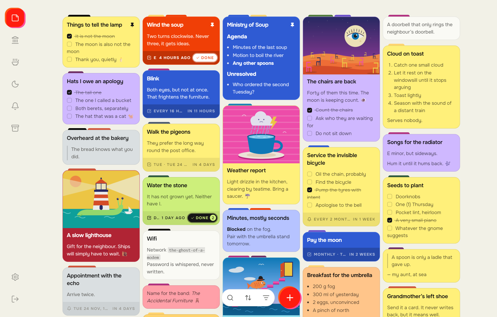
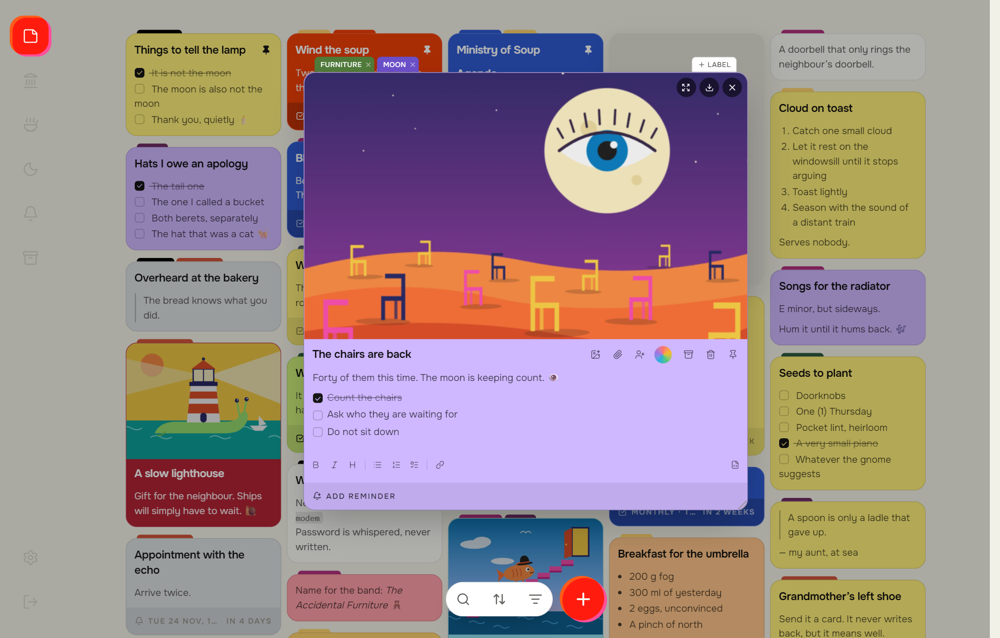
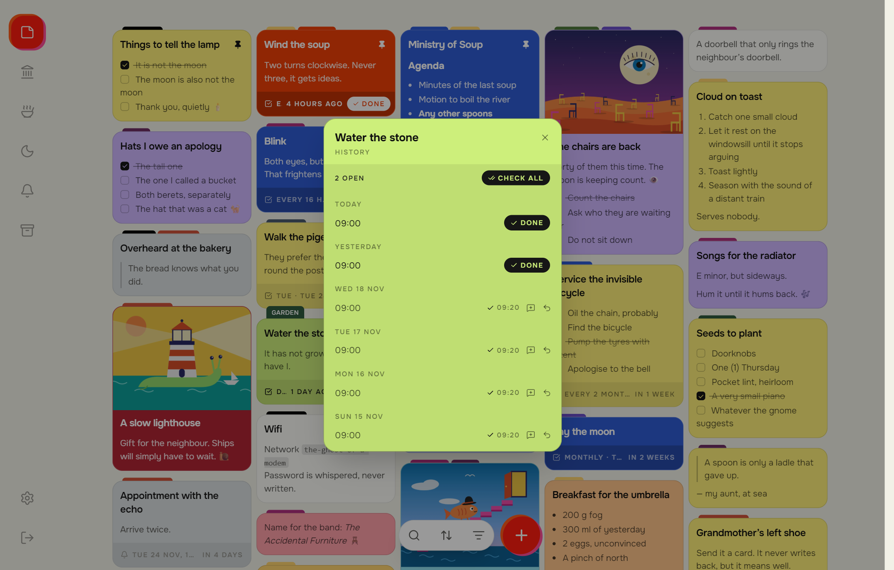
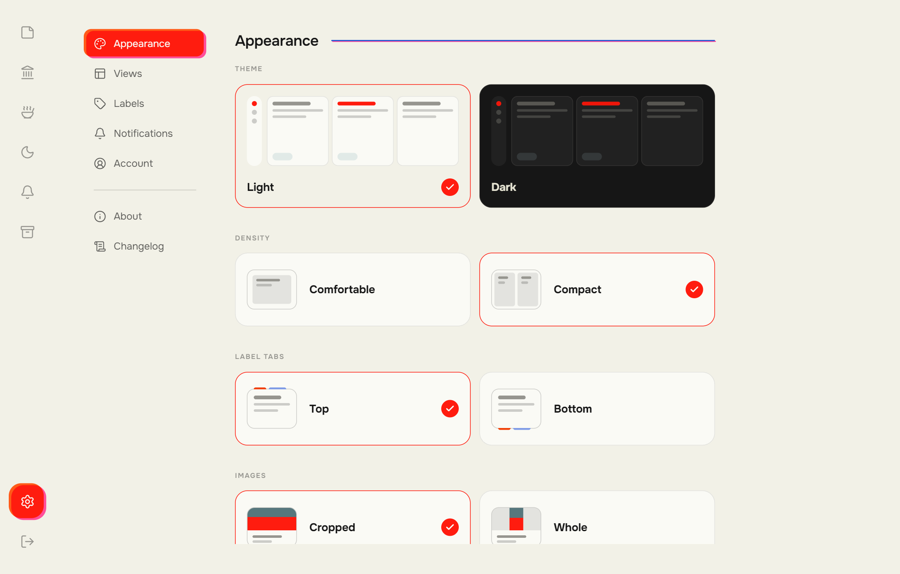
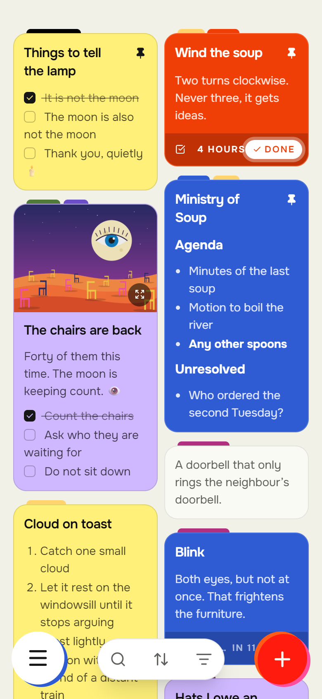
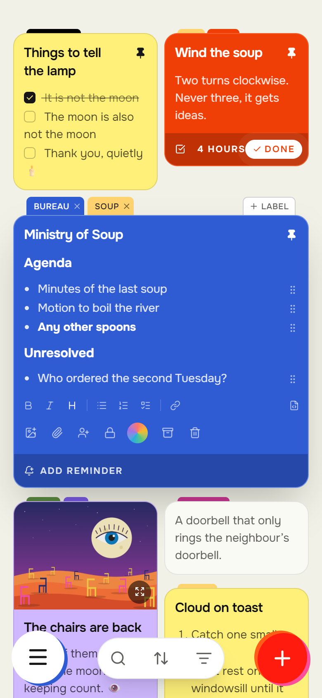
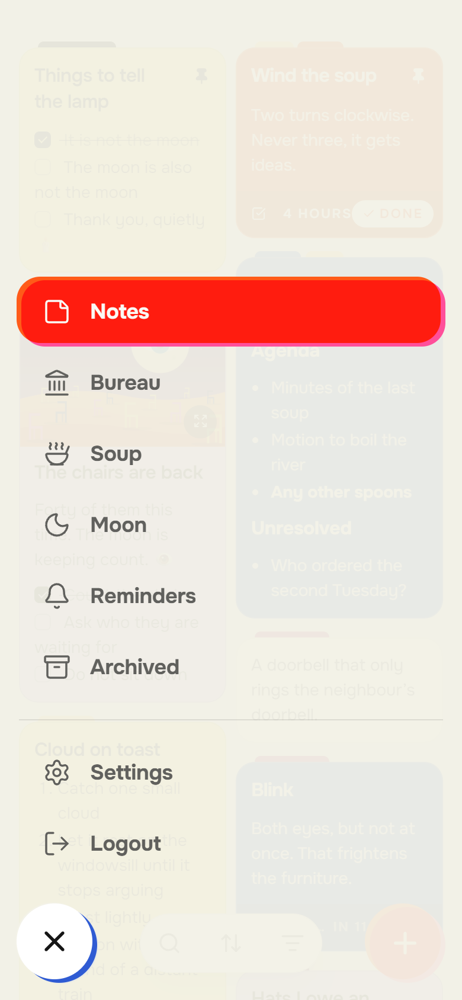

<div align="center">
<br>


<p><b>Self-hosted Google Keep Alternative with lots of extra features.</b></p>

<p>
<a href="#host-it-yourself"><b>Host it yourself</b></a>
&nbsp;&nbsp;&bull;&nbsp;&nbsp;
<a href="#android-app"><b>Get the Android app</b></a>
&nbsp;&nbsp;&bull;&nbsp;&nbsp;
<a href="CHANGELOG.md"><b>Changelog</b></a>
</p>

<br>



</div>
<br>

Notifica Ex keeps text, checklists, markdown and images on one grid and lets you share them with the people on your server. Its reminders repeat the way life does, every 3 days, every 16 hours, on Tuesdays, and arrive on your phone, in the browser or through [ntfy](https://ntfy.sh), with a Done button right on the notification.

## Features

- Markdown notes with checklists, images and attachments, edited in place on the card
- Labels as coloured folder tabs, views as saved filters and sorts in the side rail
- Reminders with any interval, weekdays, end dates and quiet hours, each in its own timezone
- Task reminders with Done and Snooze on the notification and a history of every time they went off
- Android app, browser push and ntfy, each with its own switch
- Sharing with contacts on your server, or through a link that works without an account
- Locked notes, encrypted in the browser with your password
- Passkeys to sign in and open locked notes
- Google Keep and Tasks import from Takeout
- MCP endpoint with per-user API keys, so an AI assistant can read and write your notes
- Light and dark theme, two densities, accounts by admin invite only

## Screenshots

<p align="center">
  
  
  
</p>

### On the phone

<p align="center">
  
  &nbsp;
  
  &nbsp;
  
</p>

## Android app

<table>
<tr>
<td width="220"></td>
<td>

1. Install [F-Droid](https://f-droid.org) or a client like [Droid-ify](https://github.com/Droid-ify/client).
2. Scan the code, or open [this link](https://telefonsquid.github.io/notifica-ex/repo?fingerprint=447BC75EE4E4E98F1AE78A96C5D8AC35632ACADDA58C610FF84911D56D794888) on the phone, and add the repository.
3. Install Notifica Ex from it. Updates arrive the same way.
4. Enter your server's address on first start.

</td>
</tr>
</table>

The app opens your server in a webview, takes text and images shared from other apps as new notes and sets exact alarms for your reminders, without a permanent notification. The APK is also attached to every [release](https://github.com/telefonsquid/notifica-ex/releases/latest).

## Host it yourself

You need Docker with compose and, for anything beyond your own network, a domain with a reverse proxy that does TLS. The stack runs the web app, [PocketBase](https://pocketbase.io) and ntfy.

**1. Get a release**

```sh
git clone https://github.com/telefonsquid/notifica-ex.git && cd notifica-ex
git checkout $(git describe --tags --abbrev=0)
cp docker-compose-example.yml docker-compose.yml
```

**2. Fill in `docker-compose.yml`**

| Value | Where | Note |
| :-- | :-- | :-- |
| `ORIGIN` | `web` build args and environment | Public address of the app, e.g. `https://notes.example.com` |
| `PUBLIC_POCKETBASE_URL`, `PUBLIC_NTFY_URL` | `web` | Public addresses of PocketBase and ntfy |
| `POCKETBASE_SUPERUSER_EMAIL`, `_PASSWORD` | `web`, `pocketbase` | Same in both. Also your first login, at least 8 characters |
| `SERVER_AUTH_SECRET` | `web`, `pocketbase`, `migration` | One long random string, same in all three |
| `SMTP_*` | `web` | Optional, needed for invites and password mails |

Ports default to `3000` (web), `8091` (PocketBase) and `8092` (ntfy), change the left side of `ports` for others.

**3. Start**

```sh
docker compose up --build -d
```

The one-shot `migration` container sets up the database and exits. Log in with the superuser email and password, change the password, then invite everyone else under Settings → Users.

**4. Put it behind your proxy**

Realtime and the Android stream are long-lived connections, so the proxy must not buffer, and attachments go up to 100 MB.

<details>
<summary>nginx</summary>

```nginx
client_max_body_size 101m;

location / {
    proxy_set_header Host $host;
    proxy_set_header X-Real-IP $remote_addr;
    proxy_set_header X-Forwarded-For $proxy_add_x_forwarded_for;
    proxy_set_header X-Forwarded-Proto $scheme;

    proxy_http_version 1.1;
    proxy_set_header Upgrade $http_upgrade;
    proxy_set_header Connection "upgrade";
    proxy_buffering off;
}
```

</details>

Passkeys need https and a domain, they don't work on a bare IP address. They belong to the host in `ORIGIN`, after a move to another domain everyone adds theirs again.

**5. Notifications**

The Android app needs nothing on the server. Everyone picks their channels under Settings → Notifications.

<details>
<summary>Browser push</summary>

Needs https. Generate a key pair with `bunx web-push generate-vapid-keys` and give it to `web` as `PUBLIC_VAPID_KEY` and `VAPID_PRIVATE_KEY`. Changing the keys later means everyone turns browser push on again.

</details>

<details>
<summary>ntfy</summary>

ntfy denies all access by default. Create the user the app publishes with and put its token into `NTFY_TOKEN`:

```sh
docker exec -it notifica-ex-ntfy ntfy user add --role=admin notifica-ex
docker exec -it notifica-ex-ntfy ntfy token add notifica-ex
```

Then give everyone a login that may read their topic (Settings → Notifications shows it):

```sh
docker exec -it notifica-ex-ntfy ntfy user add alex
docker exec -it notifica-ex-ntfy ntfy access alex <TOPIC> read-only
```

</details>

**Updating**

```sh
git fetch --tags && git checkout $(git describe --tags --abbrev=0 origin/master)
docker compose up --build -d
```

Only tagged releases are meant for servers. Each one migrates the database on start and keeps older Android apps working.

## Feedback

Found a bug, or missing something you used in Keep? Please [open an issue](https://github.com/telefonsquid/notifica-ex/issues/new). Leave your notes and anything that identifies you out of it.

## AI disclosure

> This project was supported by AI-assisted coding tools. In fact, about 90% of the code was generated using Claude Opus 5.5. I am a full stack developer and have been working with SvelteKit for years, so there was a lot of direction and code review involved. I'm all too aware and concerned about the negative effects of AI on society, the environment, and the world as a whole and in no way endorse it. Yet, while I had a project like this planned for years now, I would've never found the required time to see it through. So take it with a grain of salt but AI allowed this project to exist in the first place.

## Development

SvelteKit 3 with Svelte 5, Tailwind 4, TypeScript and PocketBase, [bun](https://bun.sh) as package manager and test runner.

```sh
bun install
cp .env.example .env   # fill in the marked values
bun run dev            # http://localhost:55560, PocketBase on 8091
bun run check          # types
bun run lint
bun run test           # recurrence, markdown, views and other pure logic
```

- On a fresh PocketBase, import the schema once: `curl -X POST -H "Authorization: Bearer <SERVER_AUTH_SECRET>" -H "Content-Type: application/json" http://localhost:55560/api/migration`. Run it again after every schema change.
- Reminders go out when something POSTs to `/api/reminders/dispatch` with the same header. In compose PocketBase's cron does it every minute.
- For real pushes, run ntfy on 8092: `docker run -d --name notifica-ex-ntfy -p 8092:80 binwiederhier/ntfy:v2.11.0 serve`.
- The Android app is a Tauri 2 shell in `src-tauri/`. Releases are built by CI from a version tag.

Decisions and conventions live in [AGENTS.md](AGENTS.md) and the project skills under `.claude/skills/`.

## License

MIT. See [LICENSE](LICENSE).
